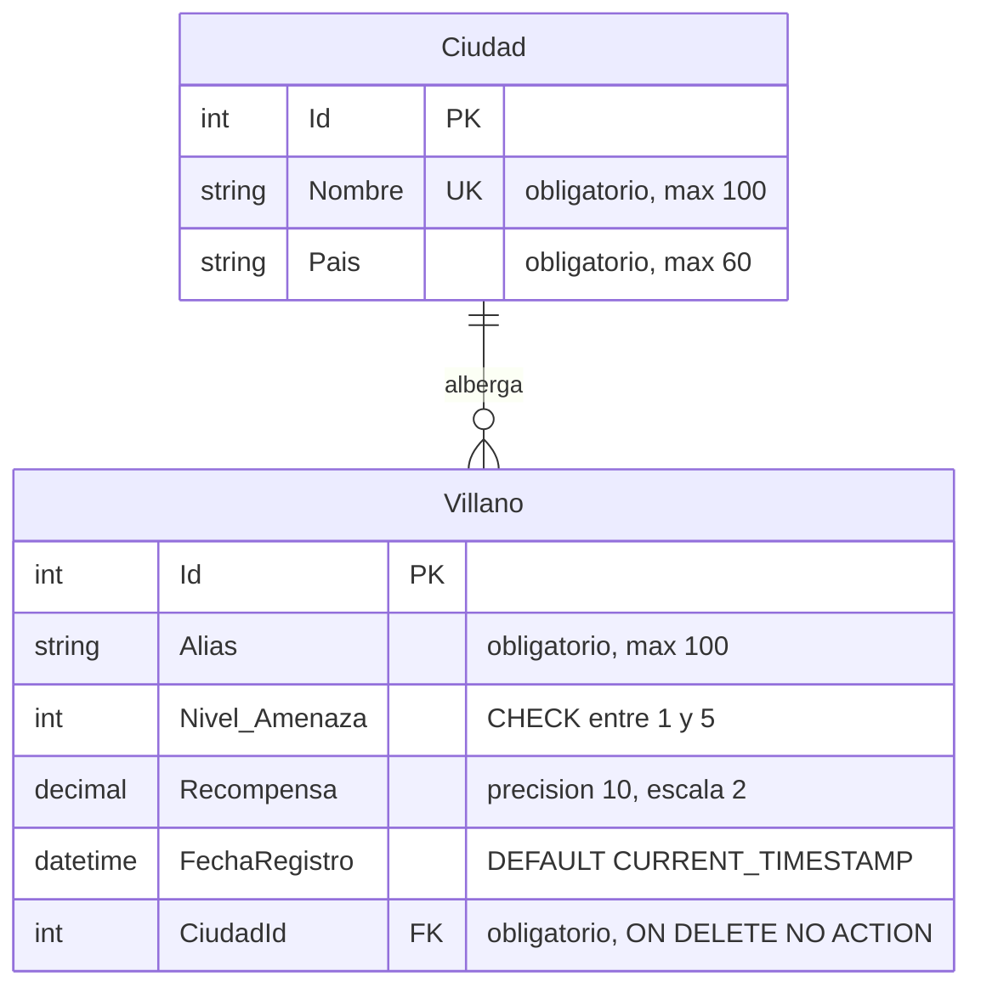
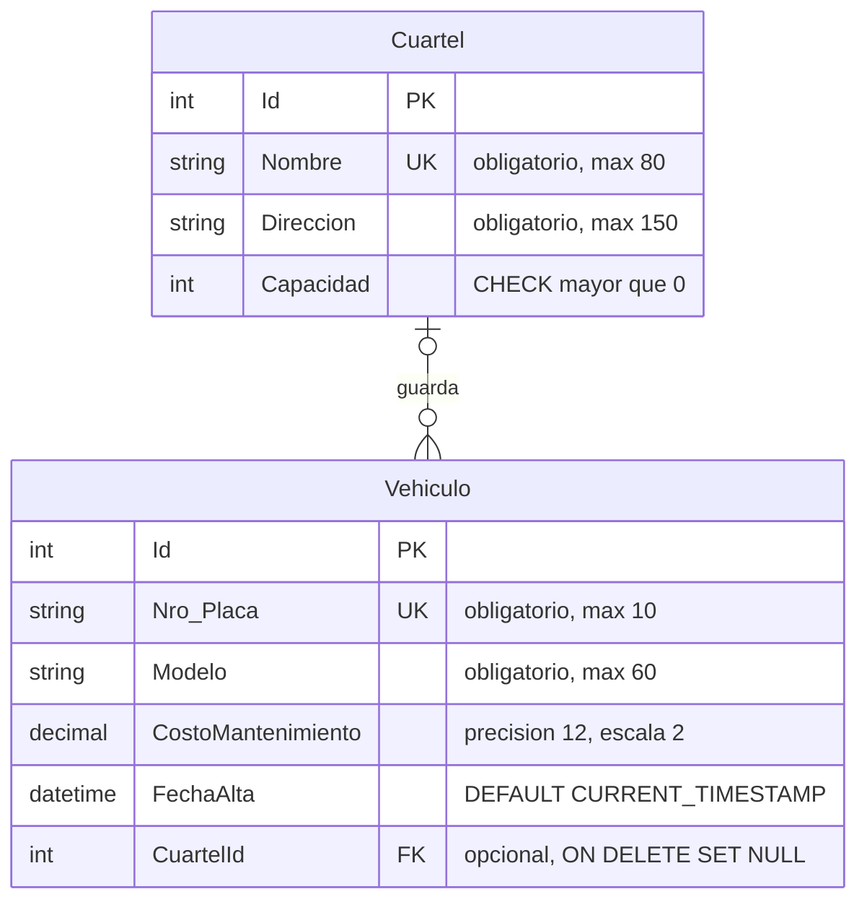

# Práctica de Fluent API con SQLite

La práctica usa el contexto `HeroesContext` y el controlador MVC `LaboratorioEfController` del proyecto. `HeroesMvc` y `HeroesDbContext` son los nombres del ejemplo; no es necesario renombrar el proyecto ni convertir las páginas existentes a MVC.

## Base de datos

Las cuatro tablas y los datos de ejemplo están en `Data/HeroesDb.db`. Se crearon con `Data/Clase02_FluentApi.sql`, sin migraciones nuevas. Para preparar otra copia de la base o repetir el script desde la carpeta del proyecto:

```sh
sqlite3 Data/HeroesDb.db < Data/Clase02_FluentApi.sql
```

El script puede repetirse sin duplicar los ejemplos y no reemplaza los registros existentes. Las migraciones anteriores se conservan como historial; esta práctica se prepara con el script SQL.

SQLite no usa el esquema `dbo`. Las fechas automáticas usan `CURRENT_TIMESTAMP`, en UTC, en lugar de `GETDATE()`. Los importes siguen siendo `decimal` en C# y se almacenan como texto para conservar su valor.

`HasMaxLength` y `HasPrecision` quedan configurados y se pueden consultar en los metadatos. SQLite no impone por sí mismo esas longitudes ni la precisión y escala. Sí se comprueban en la base las claves foráneas, los índices únicos, el rango de amenaza y la capacidad positiva. Estas diferencias están descritas en la [documentación de tipos de SQLite para .NET](https://learn.microsoft.com/en-us/dotnet/standard/data/sqlite/types).

## Diagramas de entidades y relaciones



Cada villano pertenece a una ciudad. Una ciudad puede no tener villanos o tener varios; no se puede eliminar mientras tenga villanos.



Un vehículo puede tener un cuartel o ninguno. Un cuartel puede tener cero o muchos vehículos. Al borrar el cuartel, los vehículos se conservan con `CuartelId = null`.

## Consultas del laboratorio

Ejecutar `dotnet run` e iniciar sesión. Usar la dirección que muestre la aplicación y estas rutas:

| Ruta con los datos actuales | Resultado comprobado |
| --- | --- |
| `/LaboratorioEf/Ciudad/1` | La Paz, con Sombra Roja y Doctor Niebla |
| `/LaboratorioEf/Ciudad/2` | Santa Cruz, con lista vacía |
| `/LaboratorioEf/ModeloVillano` | `Nivel_Amenaza`, longitud 100 del alias, precisión 10 y escala 2, fecha con `CURRENT_TIMESTAMP` |
| `/LaboratorioEf/Cuartel/1` | Base Illimani, con Halcón X1 y Rayo T2 |
| `/LaboratorioEf/Cuartel/2` | Base Oriente, con lista vacía |
| `/LaboratorioEf/Ciudad/9999999` y `/LaboratorioEf/Cuartel/9999999` | HTTP 404 |

Si se usa otra base, consultar primero los identificadores:

```sql
SELECT Id, Nombre FROM Ciudades;
SELECT Id, Nombre FROM Cuarteles;
SELECT Nro_Placa, Modelo, CuartelId FROM Vehiculos;
```

El vehículo Tortuga M3, placa `1111-DEF`, se registra sin cuartel.

## Comprobar las configuraciones

En `Data/HeroesContext.cs`, comentar temporalmente solo el registro de `VillanoConfiguration` y reiniciar la aplicación. En `ModeloVillano`, la columna vuelve a llamarse `NivelAmenaza` y desaparecen la longitud del alias y la precisión de la recompensa. La consulta de ciudad falla con `no such column: v.NivelAmenaza`.

Restaurar la línea. Luego repetir con `VehiculoConfiguration`: la consulta del cuartel falla porque EF busca `Placa` en lugar de `Nro_Placa`. Restaurar también esa línea al terminar. Ambos fallos se comprobaron con contextos de prueba equivalentes; el proyecto entregado conserva las cuatro configuraciones activas.

## Comprobar las restricciones en SQLite

Abrir la base con `sqlite3 Data/HeroesDb.db`. Ejecutar `PRAGMA foreign_keys = ON;` antes de las transacciones. Probar cada bloque por separado y ejecutar su `ROLLBACK` incluso después del error esperado.

```sql
PRAGMA foreign_keys = ON;

-- Debe fallar por nombre de ciudad repetido.
BEGIN;
INSERT INTO Ciudades (Nombre, Pais) VALUES ('La Paz', 'Bolivia');
ROLLBACK;

-- Debe fallar por CK_Villanos_NivelAmenaza.
BEGIN;
UPDATE Villanos SET Nivel_Amenaza = 9 WHERE Id = (SELECT MIN(Id) FROM Villanos);
ROLLBACK;

-- Debe fallar por la clave foránea de los villanos.
BEGIN;
DELETE FROM Ciudades WHERE Nombre = 'La Paz';
ROLLBACK;

-- Debe fallar por placa repetida.
BEGIN;
INSERT INTO Vehiculos (Nro_Placa, Modelo, CostoMantenimiento)
VALUES ('2345-ABC', 'Duplicado', '1.00');
ROLLBACK;

-- Debe fallar por CK_Cuarteles_Capacidad.
BEGIN;
UPDATE Cuarteles SET Capacidad = 0 WHERE Nombre = 'Base Illimani';
ROLLBACK;

-- Debe permitir borrar el cuartel y conservar los vehículos sin asignación.
BEGIN;
DELETE FROM Cuarteles WHERE Nombre = 'Base Illimani';
SELECT Nro_Placa, Modelo, CuartelId FROM Vehiculos;
ROLLBACK;
```

Las pruebas anteriores pasaron sobre una copia temporal de la base. También se verificaron los valores automáticos al insertar desde EF, la lectura y escritura de decimales, la ausencia de claves foráneas duplicadas y las funciones del laboratorio de la clase 1. Los datos originales de héroes, superpoderes y usuarios se conservaron.

Las respuestas están en [Clase02_Respuestas.md](Clase02_Respuestas.md).
